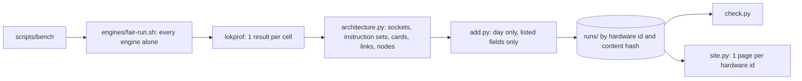

# Contributing

## Runs

Share the runs of your machine as [Share your runs](https://loken-ai.github.io/benchmarks/share-your-runs/) says.
Run `scripts/check.py` on your records before the pull request.
Do not edit a record, and do not add one taken under another protocol than the campaign's.

## Code

- Python 3.11 and the standard library only. The scripts run on Linux.
- `python3 -m unittest discover tests` and `node --test tests/*.test.js` pass before a pull request.
- `shellcheck -S warning scripts/bench scripts/enable-energy.sh scripts/engines/*.sh` reports nothing.
- A change to how a record is filed, checked or described comes with a test in `tests/`.
- One commit, one capability.
  The subject follows Conventional Commits, in lower case and in the imperative: `feat(runs): file a run without the time it was taken`.
  The body says what was wrong as a user saw it, then what the code does now.
- English for code, comments, documentation and commit messages.

## Layout

| Path | Holds |
|---|---|
| `scripts/bench` | the campaign driver |
| `scripts/engines/fair-run.sh` | the isolation protocol: 1 cell, every engine alone |
| `scripts/engines/gpu-policy.sh` | which cards each engine sees, and the detection of the cards |
| `scripts/engines/vllm-serve-hf.sh`, `scripts/engines/vllm-serve-ollama.sh` | the vLLM launchers |
| `scripts/architecture.py` | describes the machine and its cluster, and adds it to a record |
| `scripts/enable-energy.sh` | makes the energy counters readable, and reports what is measurable |
| `scripts/add.py` | anonymises records and files them under `runs/` |
| `scripts/check.py` | checks records |
| `scripts/site.py` | builds the results site |
| `scripts/pages.py` | the layout of the site: the shell, the hero, the hardware cards and the result tables |
| `scripts/bench_row.py` | the rows of a results table, the Deltas and the marks |
| `scripts/scoreboard.py` | the count of cells won on both axes, printed after each cell |
| `scripts/records/repository.py` | where runs are filed, the listed machine fields and the anonymisation |
| `scripts/records/store.py` | the `run_id` of a record |
| `scripts/records/hardware.py` | the `hardware_id`, the `host_id` and the label of a machine |
| `scripts/records/classes.py` | the equivalence classes |
| `scripts/records/convert-archive.py` | brings an archived report to the current schema, with `converted_from` |
| `scripts/records/transform-replayed.py` | removes from a replayed-prompt record what the prompt cache served |
| `scripts/records/submissions.py` | a quarantine pool for submissions, released by a record of the same class |
| `web/` | the style sheet and the scripts of the site: the charts, the search and the table filter |
| `matrix.toml` | the axes of the matrix |
| `prompts/` | the 3 prompts, named by their size in tokens |
| `fixtures/asr/` | the speech recognition recording and its transcript, credited in `NOTICE.md` |
| `bench.toml.example` | the settings a campaign reads |
| `runs/` | the shared records, 1 folder per hardware id |
| `tests/` | the tests |

`bench.toml`, `results/` and `site/` stay out of git.

## How a campaign flows



Nothing a campaign reads is retyped by hand.

| Input | Source |
|---|---|
| the builds measured, the address of loken | `bench.toml`, copied from `bench.toml.example` |
| the store paths | the `config.toml` loken starts with: `ollama_models_dir`, `huggingface_models_dir` |
| the model list | loken's catalogue, `GET /api/tags` |
| the capability and the format of a model | the same catalogue entry: `capabilities` and `details.format` |
| the window a model declares | `model_info` of `POST /api/show`, else the `config.json` of its checkpoint in the Hugging Face store |
| the matrix axes | `matrix.toml`, public ids only |
| ollama and vLLM | the latest releases, installed under `results/engines/` |
| the speech recognition recording | `fixtures/asr/` |

## Working files

| Path | Holds |
|---|---|
| `results/<model>_<ctx>_<mode>_<prompt>.json` | the scratch copy of a cell, with `_cpu` or `_<backend>` at the end for those sweeps |
| `results/<model>_error.json` | the error cell of a model the campaign cannot measure |
| `results/engines/` | the vLLM environment, its `uv` cache and each ollama release |
| `results/lokend-catalogue.log` | the output of the `lokend` the driver starts for the catalogue |

The driver stamps each scratch file with the modification time of the `lokend` measured, as `engine_build`, and with the versions of the peer engines that produced a cell.

## What the driver guards

- **Engine versions.** It installs the latest ollama and vLLM at the start of each run and records their versions in every record.
  A campaign that cannot read the latest versions does not start.
- **Store consistency.** ollama and loken read the same store, because both derive it from the `config.toml` loken starts with.
- **Hugging Face GGUF models.** ollama imports such a model once from the file loken loads, under `hf.co/<repository>:<quantisation>`.
  The copied blob is then replaced by a hard link to that file.
  The driver asks loken for that file before the first cell stops loken.
- **Idle cards.** A run refuses to start while an NVIDIA card is more than 5% busy or holds more than 600 MiB, or an AMD card is more than 5% busy.
  It reads the idle temperature of the cards once, before any cell.
- **Declared windows.** It reads the window each model declares before the first cell stops loken, and skips the cells above it.
- **Resume.** A cell is kept when the same `lokend` and the same engine versions measured it, and when every row kept a figure or a reason.
  `KEEP_EARLIER_BUILDS=1` also keeps the complete cells of an earlier `lokend`.
- **Cell cap.** `timeout` stops a cell after `CELL_CAP` seconds, and the driver reports it interrupted.

## The isolation protocol

`scripts/engines/fair-run.sh` measures 1 cell, and the driver does not reimplement it.

- **1 engine at a time.** Before each engine it kills every engine process and its children, then waits until the NVIDIA cards hold less than 600 MiB.
- **The same cards for everyone.** `gpu-policy.sh` resolves the cards to device UUIDs in PCI order, and applies 1 policy to every engine.
  ollama gets `OLLAMA_SCHED_SPREAD=1` when it sees more than 1 card, and vLLM a tensor parallel size.
- **A pin only while the weights fit.** A restriction to 1 card is lifted when the weights exceed 91% of the largest card's memory.
  `GPU_PIN` is kept and only warned about.
- **Cold, greedy, a new prompt each time.** lokprof runs with `--warmup 0 --unique-prompt --carbon-intensity 50`, and `--stream` unless `STREAM=0`.
- **A thermal gate.** Before ollama and loken are measured on the cards, it waits until the hottest card is within `GPU_COOL_MARGIN_C`, 8 °C by default, of the idle temperature, for 600 s at most.
  On the host, it waits until the processor package is at `COOL_C`, 45 °C by default, for 120 s at most.
- **A memory scope.** Where `systemd-run --user --scope` works, each engine runs with the memory available once every engine is stopped, and no swap.
  An engine that asks for more is stopped alone, and its cell is recorded as failed.
- **A refused default configuration.** loken starts from `LOKEN_CWD`, and the run stops when that directory holds no `config.toml`.

## Records

`scripts/records/hardware.py` computes the `hardware_id` with the algorithm of lokprof.
Its `self_check` verifies the test vector of lokprof's `src/provenance.rs`.

`scripts/records/repository.py` lists the fields a machine block, a node and a card may hold.
`scripts/add.py` keeps those fields, cuts the dates to the day, and gives a CPU run the machine block of its host alone.
`scripts/check.py` applies the checks that [Record](https://loken-ai.github.io/benchmarks/record/#checks) lists, and CI runs it on every record a pull request adds or changes, and on every record on each push to `main`.

## The site

```sh
scripts/site.py
python3 -m http.server -d site
```

Open `http://localhost:8000/`.
The search page reads `index.json`, which a browser does not load from a `file://` page.

`scripts/site.py` reads every record `scripts/check.py` accepts, groups them by hardware id and writes:

| File | Holds |
|---|---|
| `site/index.html` | the counts of the campaign and 1 card per hardware id |
| `site/hw/<hardware_id>.html` | the architecture, then 1 results table per backend loken answered on |
| `site/index.json` | every row of every table, with its figures as numbers |
| `site/search.html`, `site/charts.html` | the pages that read `index.json` |

CI builds `site/` on every push to `main`.
The repository `loken-ai.github.io` publishes it.
The site and the footer of every page link to the method page of the documentation site.

## Documentation

The documentation lives in the `loken-ai.github.io` repository, under `docs/site/06-benchmarks`.
A page names no file of `scripts/` other than a command the reader runs.
