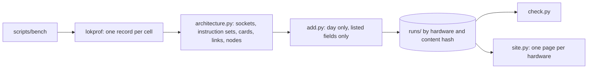

# Running the campaign

How to run a reproducible bench campaign on your machine, and where every input comes from. This
page is the procedure; there is no other.

## The shape of it

A campaign compares loken against ollama and vLLM on the models loken serves, across a matrix of
context size, prompt, streaming mode and device. It files every run in `runs/` and the site is built
from them. Three layers:

- **lokprof** is the measurement tool. It benches one model against one engine and emits a result
  JSON. It measures every modality natively (text, vision, image generation, speech synthesis,
  speech recognition), selected with `--modality`; it never guesses the modality from a model name.
- **`scripts/bench`** is the driver. It reads its inputs from their single sources, provisions the
  peer engines, drives lokprof through the isolation protocol in `scripts/engines/fair-run.sh`
  and files each result.
- **`scripts/add.py`**, **`scripts/check.py`** and **`scripts/site.py`** keep the runs: they cut what
  identifies a person or a machine, check a run, and build the site.

The builds measured are releases: the `lokend` of a loken release and the `lokprof` of a lokprof
release, named in `bench.toml`. This repository holds no copy of either.

Nothing about a campaign is retyped or maintained by hand:

| input | where it comes from |
|---|---|
| builds measured, address of loken | `bench.toml`, copied from `bench.toml.example` and kept out of git |
| store paths | the `config.toml` loken is started with (`ollama_models_dir`, `huggingface_models_dir`): one source, no split-brain |
| model list | loken's own catalogue, `GET /api/tags`: no scan, no list to maintain |
| matrix axes | `matrix.toml`, the only curated data, public ids only |
| ollama and vLLM | installed by the campaign into a compartment of its own, below |
| speech recognition fixtures | `fixtures/asr/` |

## Run it

```
cp bench.toml.example bench.toml   # name the lokend and the lokprof of your releases
scripts/bench                      # plan: print the cells a campaign would run, no side effect
scripts/bench run                  # run the campaign
```

Plan first. It prints the stores it will use, the models loken is serving, each model's engines, and
the context sizes of the full matrix, so what a campaign will do is visible before it does it. `run`
is the deliberate step: it monopolizes the machine for hours. `bench` asks loken for the catalogue and
starts the `lokend` named in `bench.toml` when none answers. It needs `python3` and `curl`.

`BENCH_ONLY="a b" scripts/bench run` measures only the named models. `CELL_CAP=<seconds>` stops a cell that runs longer
(7200 by default): a model too large for the cards can spend hours computing on the host, and the cell is then
reported as interrupted, without a result. Without `FULL=1` the run is a
fast pass: GPU, the first context window, the 100 token prompt, streaming. `FULL=1` sweeps the whole matrix.

## The whole matrix

`FULL=1 scripts/bench run` sweeps every axis of `matrix.toml`: for each device, context window, prompt
and streaming mode in that order, every model once. The prompts are three sizes of one text, 100,
1 000 and 10 000 tokens (`prompts/`), so a rate is read across the size of the input;
`docs/METHOD.md` gives their characters and words. The windows are 4096 and 131072 tokens. A window
the prompt does not fit in, or above the one a model declares (read from the metadata loken shows for it) is skipped, with a line that
says so. Each cell is one run of `fair-run.sh` on one prompt, so the servers start afresh for every
prompt, and its scratch file is `results/<model>_<ctx>_<stream|non-stream>_<prompt>[_cpu].json`. The CPU
sweeps are streamed only and have no vLLM. A generated-media cell has no such axes and is measured
once, in the first sweep, with the first prompt.

## The engine compartment

The campaign measures against the current ollama and vLLM, installed into a compartment that is the
bench's alone, never your own vLLM environment or the `ollama` on your `PATH`. They live under
`results/engines/`: a fresh vLLM environment and a versioned ollama. Their versions are recorded in
every run. The comparison is reproducible and touches no other environment.

## Energy

A run's energy is the energy the machine drew over the request: the cards, read through NVML (NVIDIA) or
the amdgpu power reading (AMD), plus the processor, read from the RAPL counters of the kernel. Those
counters are readable by root only, so each machine of a campaign needs one rule before its energy can be
measured. The script acts on the machine it runs on:

```
scripts/enable-energy.sh          # installs the rule (asks for sudo), then reports
scripts/enable-energy.sh --check  # report only, no root
```

`bench run` checks it at the start and warns. A domain that cannot be measured is left out of a record
as a missing value, never as a partial total that looks measured.

## Where results live

Every run is a record of the loken schema, filed once under the hash of what it holds:

```
runs/<hardware_id>/<run_id>.json
```

`scripts/bench` files each cell with `scripts/add.py`; so can you, for records you took by other
means. A rerun is a new file, and nothing is overwritten. `results/` is the campaign's scratch copy.



### What a record holds about the machine

A record names no person and no machine. Its machine block holds:

| field | meaning |
|---|---|
| `host_id` | a one-way hash of the machine id, so the runs of one host group together |
| `hardware_id` | a one-way hash of the cards, the processor, its threads and the memory: two machines built alike share it |
| `cpu`, `threads`, `sockets`, `ram_gib` | the processor, its hardware threads and sockets, the memory in GiB |
| `cpu_flags` | the instruction sets the host kernels choose a path by (AVX2, AVX-512, AMX) |
| `os`, `kernel`, `driver` | the distribution, the kernel, the NVIDIA driver |
| `gpus` | per card: `name`, `vendor`, `arch` (such as `sm_89` or `gfx1201`), `vram_mib`, `power_cap_w`, `pcie_gen`, `pcie_width` |
| `nodes` | for a cluster, the description of every node |

`scripts/architecture.py` reads these from `/proc`, `/sys` and the vendors' tools; nothing is typed
by hand, and a fact that cannot be read is left out. Dates keep the day (UTC) and drop the time of
day. A card's serial, a host name, a path, a private address and a mailbox never enter a record:
`add.py` drops what is outside the list and `check.py` refuses a record that keeps any.

### A cluster

List the other nodes in `bench.toml`:

```toml
[cluster]
nodes = ["user@node2", "user@node3"]
```

Each node is described by running `scripts/architecture.py` on it over ssh (it needs `python3` and
nothing else). The record then lists every node, this machine first, and its `hardware_id` is the hash
of the sorted node ids: the same machines in another order are the same cluster, and one node changed
is another.

## Backends

A card is measured through its native runtime unless `BACKEND` says otherwise:

| `BACKEND` | What runs | Who is measured |
|---|---|---|
| `native` (default) | CUDA on an NVIDIA card, ROCm on an AMD card, and the host | loken, ollama, vLLM |
| `vulkan` | the card's Vulkan device, the vendor runtimes hidden from every engine | loken and ollama |
| `opencl` | the OpenCL GPU | loken alone |

A campaign measures every card of the machine, all at once. On a machine with NVIDIA and AMD cards
that is `GPU_VENDOR=all`, chosen by default: every card of both vendors is exposed to every engine, loken
drives both vendors together, and an engine that drives one vendor only (vLLM is the CUDA build) uses
the cards of that vendor. `GPU_VENDOR=nvidia` or `amd` restricts the run to one vendor and hides the
other's cards from every engine. ollama gets its ROCm libraries, unpacked over its release, whenever an
AMD card is present. The record lists the cards loken saw, so a mixed machine is one hardware of its own.

`VULKAN_CARD` names the card by a part of its name when the vendor's own is not the one (the default
is `AMD`, `NVIDIA` or `Intel` by `GPU_VENDOR`). loken is given the card through `vulkan_devices` in a
copy of its configuration, ollama through `OLLAMA_VULKAN=1` and the card's place among the Vulkan
GPUs. Neither can fall back to CUDA, ROCm or the host for the run. An ollama without a Vulkan
backend is not run, and the campaign says so. vLLM does not run on Vulkan or OpenCL and is left out;
no reference engine runs a language model through OpenCL, and the page of that backend says so.

A backend campaign measures the GPU sweep only and writes its cells beside the native ones
(`results/<model>_<ctx>_<mode>_vulkan.json`). Each record names the backend loken answered on, read
from the devices route (`cuda`, `rocm`, `vulkan`, `opencl`, `cpu`), and the site makes one table per
backend on a hardware page.

## Modalities

Each model is measured by the clock its modality warrants; the driver picks the modality from what
loken declares and passes `--modality` to lokprof:

| modality | endpoint | headline metric | gate |
|---|---|---|---|
| text | `/api/generate`, `/v1/completions` | decode tok/s | answer not degenerate |
| vision | `/api/generate` + image | decode tok/s | as text |
| image | `/v1/images/generations` | megapixels/s | fixed-seed determinism |
| tts | `/v1/audio/speech` | real-time factor | produced audio, not silence |
| asr | `/v1/audio/transcriptions` | word error rate | produced a transcript |

An asr cell transcribes `fixtures/asr/jfk.wav` and reads its word error rate against
`fixtures/asr/jfk.txt` (`ASR_AUDIO` and `ASR_REFERENCE` point elsewhere for a one-off run). vLLM
transcribes the same Hugging Face checkpoint as the peer, its context held to the decoder length the
checkpoint declares.

A model loken lists but cannot measure is an **error cell**, visible in the report and never a
silent skip. The reason says which side lacks it: a model no engine of this build serves (it declares
no capability), or a capability lokprof has no clock for (embedding, video, midi).

## What the driver guards

- **Engine versions**: it installs and records ollama and vLLM; a stale peer is not measured silently.
- **Store consistency**: ollama and loken read the same store because both derive from the
  `config.toml` loken is started with.
- **Peer presence**: a vLLM peer checkpoint absent from the cache is caught before vLLM is asked to
  serve it, so a campaign never downloads gigabytes mid-run.
- **Thermal floor, one engine at a time**: the isolation protocol lives in
  `scripts/engines/fair-run.sh`. The peers' processes are killed, the cards return to an idle floor,
  and each engine is measured alone. The driver does not reimplement it.
- **Resume**: a cell is kept when the same loken build and the same engine versions measured it.
