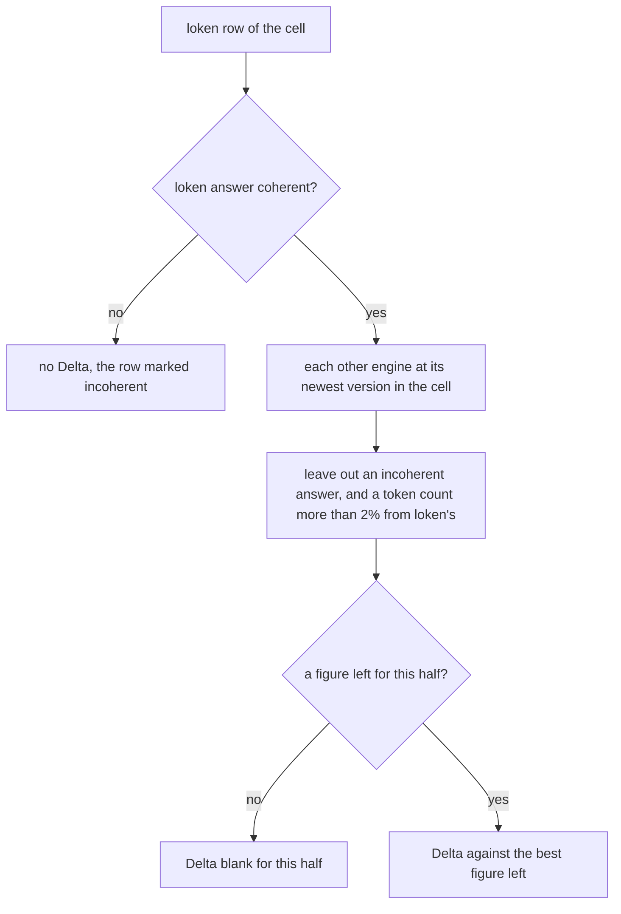

# Read a results table

A hardware page of the results site holds 1 table per backend loken answered on.
Each row is 1 engine in 1 cell, and the rows of 1 model share a shade.
The note above a table gives the number of runs and the days they span.

## Example

The rows below are 1 cell of a hardware page, read from 3 records of `runs/de70d1e2f726faf5/`.
The cell is `deepseek-r1:70b-q3ks`, window 4096, prompt `100`, stream, GPU, backend `cuda`.
The columns `Model` to `Device`, `E2E ms` and `J/token` are left out.

| Engine | Prefill tok/s | TTFT ms | Decode tok/s | Tokens | J/req | Δ prefill | Δ TTFT | Δ decode | Δ energy | Date (UTC) | Run | Status |
|---|---|---|---|---|---|---|---|---|---|---|---|---|
| Ollama 0.40.11 | 15.9 / 339.9 | 6 864 / 321 | 13.5 / 13.5 | 128 | 3 132 | | | | | 2026-10-26 | 019cda1a | submitted |
| Ollama 0.40.12 | 17.0 / 339.9 | 6 410 / 321 | 13.5 / 13.5 | 128 | 3 167 | | | | | 2026-10-28 | ab8ca5e4 | submitted |
| Ollama 0.40.6 | - | - | - | 128 | - | | | incoherent | | 2026-10-26 | 74f77385 | submitted |
| vLLM 0.32.0 | - | - | - | - | - | not run: paired with safetensors weights only | | | | 2026-10-28 | ab8ca5e4 | submitted |
| loken | 218.8 / **210.4** | 498 / **519** | 13.7 / **13.9** | 128 | 3 172 | +1186.9% / -38.1% | +1186.9% / -38.2% | +2.1% / +3.3% | -0.2% | 2026-10-28 | ab8ca5e4 | submitted |

What the example shows:

- Each rate reads cold / warm.
  The first request of the cell pays the load, as the TTFT of `Ollama 0.40.12` shows: 6 410 ms cold, 321 ms warm.
- The Deltas of the loken row compare with `Ollama 0.40.12`, the newest version of the cell.
  `Ollama 0.40.11` stays in the table and is not compared.
- `Ollama 0.40.6` gave an incoherent answer.
  Its rates are withheld and its token count kept.
- vLLM gets no GGUF model, so its row holds a mark and dashes.
- On the site, the cold figure is dimmed and the warm figure of the loken row is bold.
- On the site, a positive Delta is green and a negative one red.

## Before you compare 2 rows

Check the `Date (UTC)` and the `Run` of each row.
A page holds cells from several runs and builds, and the newest measurement of a cell wins.

`Device` says `GPU` or `CPU`.
It separates the cards from the host, not 1 card from 2.
2 cards flatter loken, because ollama splits a model that fits on 1: olmoe measured 496 tok/s on a single card, and 390 given the machine.

## Columns

<!-- site: widget table id=benchmarks-results-table-columns -->
| Column | Holds |
|---|---|
| `Model` | the name loken lists the model under |
| `Ctx` | the context window each engine was asked to reserve, in tokens |
| `Prompt (tokens)` | the prompt, named by its size: `100`, `1000` or `10000` |
| `Mode` | `stream` or `non-stream` |
| `Device` | `GPU` when the engines had the cards, `CPU` when they had the host alone |
| `Engine` | `loken`, `Ollama <version>` or `vLLM <version>`, the version the record states for the engine. `loken <version> + <drafter>` is loken with a drafter named in its configuration |
| `Prefill tok/s` | prompt tokens over the time to first token, cold / warm. |
| `TTFT ms` | the time to first token, in milliseconds, cold / warm |
| `Decode tok/s` | generated tokens per second, from the first generated token to the last, cold / warm |
| `Tokens` | the generated tokens, the mean over the iterations |
| `E2E ms` | the duration of the whole request, the mean over the iterations, in milliseconds |
| `J/req` | the energy of the whole request, in joules: `J/token` times `Tokens` |
| `J/token` | the energy per generated token, the median over the iterations, in joules |
| `Δ prefill` | how much faster loken prefills than the best other engine, in percent, cold / warm |
| `Δ TTFT` | how much shorter the time to first token of loken is, in percent, cold / warm |
| `Δ decode` | how much faster loken decodes, in percent, cold / warm |
| `Δ energy` | how much less energy per request loken uses, in percent |
| `Date (UTC)` | the day the cell was measured |
| `Run` | the first 8 hexadecimal digits of the run id of the record behind the row |
| `Status` | `submitted` or `confirmed`, the status of that record |
<!-- site: end -->

A row of a non-stream cell has no time to first token, so its `Prefill tok/s` and `TTFT ms` are dashes.
A figure the cell has no value for is a dash.
In a rate column, the cold figure is dimmed, and the warm figure of a loken row is bold.
A cell of a single iteration shows its cold figure and a dash.

## Delta

A Delta compares the loken row with the best other engine of the cell.
It compares cold with cold and warm with warm.
A positive Delta means loken is better: faster prefill and decode, a shorter time to first token, fewer joules.
A positive Delta is shown in green, a negative one in red.

A Delta is blank in each of these cases:

- The engines generated token counts more than 2% apart.
- The answer of the loken row is incoherent.
- No other engine of the cell has a comparable figure for that half.

An older version of an engine stays in the table beside the newer one, and is no longer compared.
A cell the newest version has not measured keeps the older one as reference.

`Δ energy` compares only totals over the same energy domains: the cards alone, or the cards and the processor.

## Cells that publish no rate

<!-- site: widget table id=benchmarks-results-table-marks -->
| Mark | Meaning |
|---|---|
| `incoherent` | the answer repeats itself. Its rates are withheld and its token count kept |
| `no answer` | 1 token back, no decode interval to divide by. Prefill, latency and joules stand |
| `unsupported: <reason>` | the engine was given the model and could not run it: an architecture it does not know, weights it cannot hold, a model it does not have. The reason is the engine's own |
| `not run: <reason>` | the harness gives the engine no way to take this model: no endpoint for that kind of generation, or weights in a format the engine is not paired with |
| `failed` | the engine took the model and no iteration survived: a request the bench gave up on, or one the engine refused. The record carries the error of each iteration |
<!-- site: end -->

`incoherent` and `no answer` stand in the `Δ decode` column.
The other marks stand in the `Δ prefill` column, with dashes in every figure.

## Generated media

The tables hold the rates of text and vision cells.
The figures of an image, speech synthesis, audio generation or speech recognition cell stay in its record: megapixels per second, real-time factor, word error rate.
Such a loken row shows `failed`.
An engine the harness does not run for the model shows `not run` with the reason.

## Engine labels

A loken row is labelled `loken` without a number when the site reads no version from its record.
An ollama or vLLM row whose record states no version is labelled without a number too.

## Other views

The box above each table filters its rows by the words of the `Model` and `Engine` columns.
`Chart these rows` opens the chart of every model on that hardware and backend.
The search page holds every row of every hardware, sorts by any column and downloads the rows shown as CSV.
