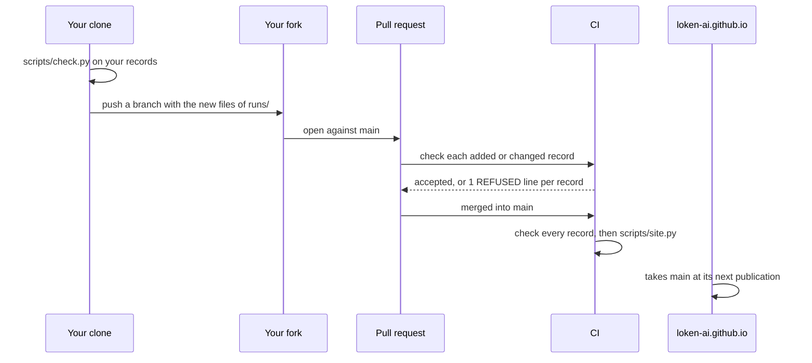

# Share your runs

Publish the records of your machine on the results site through a pull request.

## Before you start

<!-- site: widget checklist id=benchmarks-share-prereq -->
- [ ] The campaign filed your records under `runs/<hardware_id>/`.
- [ ] A fork of <https://github.com/loken-ai/benchmarks> on GitHub.
- [ ] You agree to publish your records under [CC BY 4.0](https://creativecommons.org/licenses/by/4.0/).
<!-- site: end -->

## Run it

<!-- site: widget steps id=benchmarks-share-steps -->
1. Check your records.

   ```sh
   scripts/check.py runs/<hardware_id>/*.json
   ```

2. Commit the new files under `runs/` to a branch of your fork.
   Commit no other change with them.

   ```sh
   git switch -c runs-<hardware_id>
   git add runs/
   git commit -m "feat(runs): add the runs of <hardware_id>"
   git push -u origin runs-<hardware_id>
   ```

3. Open a pull request against `main`.
   The checks run on every record the pull request adds or changes.
<!-- site: end -->

CI checks the records of the pull request, and builds the results site from `main`.
The repository `loken-ai.github.io` publishes the site, from the `main` it takes at its next publication.



Do not edit a record.
Its file name is the hash of its content, and an edited record fails the name check.

## Records taken by other means

A record taken outside `scripts/bench run` goes through `scripts/add.py`.
It cuts the dates to the day and the machine block to the listed fields, then files the record under its hash.

```sh
scripts/add.py <result>.json
```

A CPU run loses its cards and gets the hardware id of its host alone.
A record already held is skipped.

## Expected result

```
filed <n>, <k> already held, 0 refused
<n> record(s) accepted, 0 refused
```

The first line comes from `scripts/add.py`, the second from `scripts/check.py`.
Once the pull request is merged, the results site shows the records on the page of their hardware id, marked `submitted`.
A record turns `confirmed` when another host measured the same equivalence class on the same hardware id.

## What a record says about your machine

| Holds | Never holds |
|---|---|
| the processor, its threads, its sockets, the instruction sets host kernels use, the memory | a card serial |
| each card: name, maker, architecture, memory, power cap, PCIe link | a host name |
| the kernel, the distribution and the NVIDIA driver | a path |
| for a cluster, the same for every node | a private address |
| the day of the run, in UTC | a time of day, a mailbox |
| the hardware id and the host id, 2 one-way hashes | |

[Record](../03-reference/02-record.md) lists every field.

## Troubleshooting

Each refused record gets 1 line `REFUSED <file>: ` with every reason.

| Reason | Cause | Fix |
|---|---|---|
| `named <a>, its content hashes to run_id <b>` | The record was edited, or renamed. | File the original with `scripts/add.py`. |
| `in folder <a>, its machine is hardware_id <b>` | The record sits in the folder of another hardware id. | File it with `scripts/add.py`. |
| `a date carries a time of day` | The record was not filed through `scripts/add.py`. | File it with `scripts/add.py`. |
| `machine fields outside the list: ...` | The machine block holds a field the record may not state. | File it with `scripts/add.py`, which removes them. |
| `a string names a path, a private address or a mailbox: ...` | A value of the record holds personal data. | Remove the value at its source, then measure again. |
| `card <i> states no name` or `states no vram_mib` | The run did not read the card whole. | Measure again with the vendor tools installed. |
| `protocol <key> is <value>, the campaign uses <value>` | The record was measured under another protocol. | Measure with `scripts/bench run`. |
| `prompt '<p>' is not one of the protocol's` | The record used another prompt. | Measure with `scripts/bench run`. |
| `duplicate of <path>` | The same record is already in the repository. | Leave it out of the pull request. |
