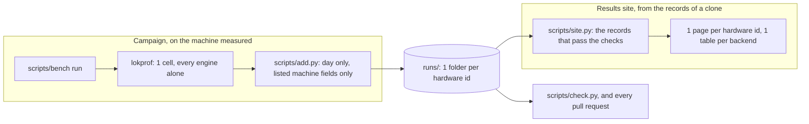

# Concepts

## Campaign

A campaign measures the models loken serves, on 1 machine, under 1 protocol.
The driver reads the models from loken's catalogue and the axes from the matrix of the repository.
It installs the latest ollama and vLLM into a directory of its own, and measures each cell with lokprof.

The campaign and the results site meet only at `runs/`.
The campaign files its records there, on the machine it measures.
`scripts/site.py` builds the site from the records of a clone, on any machine.
CI builds and publishes it on every push to `main`.

## Cell

A cell is 1 model, 1 context window, 1 prompt, 1 mode, 1 device and 1 engine.
lokprof measures it in 3 iterations, each with a prompt no engine has seen.

A row of a results table is 1 engine in 1 cell.
The other engines of the same cell sit in the rows beside it.

An error cell stands for a model loken lists and the campaign cannot measure.
It holds the reason and no figure, so a missing rate never passes for a cell nobody tried.

## Protocol

The protocol is what every cell of a campaign shares: 3 iterations, no warm-up, a cap of 128 generated tokens, a new prompt at each iteration, streaming on or off.
A record states its protocol, and a record of another protocol is refused.
[Method](../METHOD.md) says how a cell is measured under it.

## Record

A record is the result of 1 run, in the loken schema.
It holds the cells of the run, the protocol, the versions of the engines and a description of the machine.

A record is filed once under the hash of its content.
A rerun is a new record, and no record is overwritten.
[Record](../reference/record.md) gives its format.

## Hardware id and host id

The hardware id is a one-way hash of the cards, the processor, its threads and the memory.
2 machines built alike share it, and a changed card gives another one.
A results page exists for each hardware id.

The host id is a one-way hash of the machine id of the operating system.
It groups the runs of 1 machine and names no one.

## Equivalence class

An equivalence class groups the records whose measurements compare.
Its key is the major version of the schema, the protocol and its flags, the machine with its kernel and its driver, and each engine with its build and its backend.

A field a record does not state is unknown, and unknown is a class of its own.

## Status

A record is `submitted` once it passes the checks.
It becomes `confirmed` when another host measured the same equivalence class on the same hardware id.
A record without a host id confirms nothing.

## Backend

The backend is the runtime loken answered on: `cuda`, `rocm`, `vulkan`, `opencl` or `cpu`.
A hardware page holds 1 table per backend.

## Cold and warm

Cold is the first iteration of a cell, the first request after the engine started.
Warm is the median of the later iterations.
Each rate column shows both, cold first.

## Terms

| Term | Meaning |
|---|---|
| Campaign | The cells measured on 1 machine under 1 protocol |
| Cell | 1 model, window, prompt, mode, device and engine |
| Error cell | A model loken lists that the campaign cannot measure, with the reason |
| Protocol | 3 iterations, no warm-up, 128 tokens, a new prompt each time, streaming on or off |
| Record | The result of 1 run, filed under the hash of its content |
| Hardware id | A hash of the cards, processor, threads and memory |
| Host id | A hash of the machine id, grouping the runs of 1 machine |
| Equivalence class | The records whose measurements compare |
| Submitted | A record that passed the checks |
| Confirmed | A record that another host matched on the same hardware |
| Backend | The runtime loken answered on |
| Cold | The first iteration of a cell |
| Warm | The median of the later iterations |
| Delta | How much better loken is than the best other engine of the cell, in percent |
